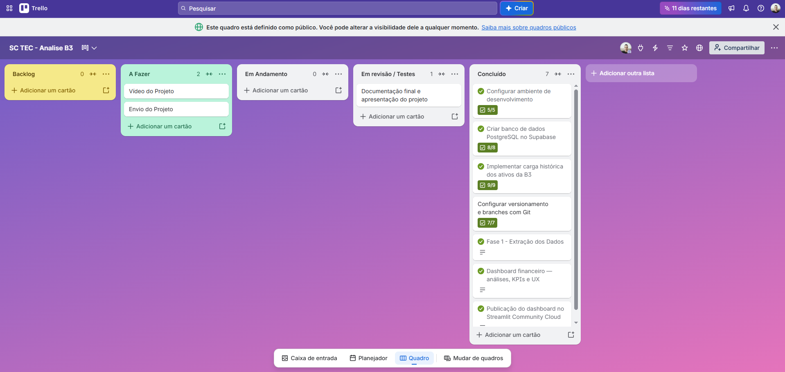

# B3 Market Analysis — Performance de Ações e Séries Temporais

Dashboard interativo de Business Intelligence para analisar o desempenho histórico de ações negociadas na B3. A aplicação permite comparar rentabilidade acumulada, volatilidade, distribuição dos retornos diários, drawdown e tendências de preços, com indicadores financeiros e filtros interativos.

**Aplicação pública:** [B3 Market Analysis — Streamlit Community Cloud](https://stefanolaurito-b3-market-analysis-app-yotwkt.streamlit.app/)

**Repositório GitHub:** [stefanolaurito/b3-market-analysis](https://github.com/stefanolaurito/b3-market-analysis)

**Quadro Kanban:** [SC TEC — Análise B3 no Trello](https://trello.com/b/PxEvdEjS)

O projeto foi desenvolvido para a atividade avaliativa de Visualização de Dados e Business Intelligence do SC TEC. Sua finalidade é educacional e analítica, não constituindo recomendação de compra ou venda de ativos.

---

## 1. Contexto de negócio

Investidores e gestores precisam avaliar o desempenho histórico e os riscos associados aos ativos antes de tomar decisões financeiras. Entretanto, comparar diferentes ações exige padronização dos retornos, análise de volatilidade e compreensão das perdas ocorridas ao longo do tempo.

O **B3 Market Analysis** reúne essas informações em um dashboard interativo, permitindo explorar os dados por ativo, setor e período.

A aplicação busca responder às seguintes perguntas de negócio:

1. Como evoluiu o desempenho comparativo das ações em uma escala normalizada Base 100?
2. Quais ativos apresentaram uma relação historicamente mais favorável entre retorno e volatilidade?
3. Como se distribuem os retornos diários e o que a assimetria e a curtose indicam sobre o comportamento dos dados?
4. Qual foi o drawdown máximo de cada ativo e qual apresentou a menor queda máxima no período analisado?
5. Como os preços ajustados se comportaram em relação às médias móveis simples de 21 e 50 pregões?

Os resultados devem ser interpretados dentro do período histórico selecionado, considerando as limitações metodológicas descritas neste documento.

## 2. Universo de ativos e período analisado

A aplicação trabalha com 12 ativos brasileiros, distribuídos em categorias setoriais para facilitar a comparação.

| Ticker | Setor atribuído no projeto |
|---|---|
| WEGE3 | Bens industriais |
| EMBJ3 | Aeroespacial |
| VALE3 | Mineração |
| GGBR4 | Siderurgia |
| KLBN11 | Papel e celulose |
| PETR4 | Petróleo e gás |
| PRIO3 | Petróleo e gás |
| EGIE3 | Energia elétrica |
| ITUB4 | Bancário |
| BBDC4 | Bancário |
| ABEV3 | Bebidas |
| RENT3 | Locação de veículos |

**Período:** 1º de janeiro de 2021 a 31 de dezembro de 2023, correspondente ao intervalo temporal solicitado na atividade. Considerando as datas efetivamente retornadas pelo provedor e a disponibilidade dos pregões, a base utilizada compreende registros de 04/01/2021 a 28/12/2023.

### Mudança de ticker da Embraer: EMBR3 → EMBJ3

O enunciado original da atividade menciona o ticker `EMBR3`. Entretanto, a Embraer anunciou que suas ações ordinárias passariam a ser negociadas na B3 sob o código `EMBJ3`, em substituição ao código `EMBR3`, a partir de **3 de novembro de 2025**.

Por esse motivo, o projeto utiliza `EMBJ3.SA` na extração dos dados e apresenta `EMBJ3` no dashboard.

A mudança de ticker ocorreu depois do período histórico analisado, de 2021 a 2023. A adoção do novo código é uma atualização de nomenclatura para a identificação do mesmo emissor, não a inclusão de uma empresa diferente.

## 3. Fonte dos dados e condições de uso

A extração é realizada por meio da biblioteca Python `yfinance`, que consulta dados históricos disponibilizados pelo Yahoo Finance.

Embora o projeto seja voltado ao mercado de ações brasileiro, é importante esclarecer que **a aplicação não consome diretamente uma API oficial da B3**. A cobertura, a disponibilidade e os ajustes das séries dependem do provedor consultado.

- Provedor de dados: [Yahoo Finance](https://finance.yahoo.com/)
- Biblioteca utilizada: [yfinance](https://github.com/ranaroussi/yfinance)
- Periodicidade: diária.
- Recorte temporal: 2021–2023.
- Formato de armazenamento: PostgreSQL, com exportação para CSV como alternativa local.

O uso e a redistribuição dos dados devem observar os termos aplicáveis ao provedor. Este documento não presume a existência de uma licença específica de redistribuição dos dados históricos.

## 4. Pipeline de engenharia de dados (ETL)

O processo de extração, transformação e carga é implementado no arquivo `carregar_dados.py`.

### 4.1. Extração

O script consulta os históricos dos 12 ativos configurados usando `yfinance`, com o parâmetro `auto_adjust=False`, preservando os campos de fechamento original e fechamento ajustado quando fornecidos pelo provedor.

### 4.2. Transformação e padronização

Os dados passam pelas seguintes etapas:

- Tratamento de colunas que eventualmente chegam no formato `MultiIndex`.
- Renomeação das colunas para uma estrutura padronizada.
- Conversão das datas para tipos de data.
- Conversão dos preços e do volume para tipos numéricos.
- Tratamento de valores inválidos por coerção para nulos.
- Remoção de registros sem data, fechamento ou fechamento ajustado válidos.

### 4.3. Carga e controle de duplicidades

Os registros tratados são gravados na tabela `public.historico_acoes`, no PostgreSQL/Supabase.

A carga utiliza a combinação de data e ticker como chave de conflito, com `ON CONFLICT (data, ticker) DO NOTHING`, evitando reinserir registros que já existem para o mesmo ativo e pregão.

### 4.4. Exportação e contingência

O arquivo `exportar_csv.py` permite exportar os registros do banco para `historico_acoes.csv`.

O dashboard prioriza a conexão com PostgreSQL/Supabase e utiliza um mecanismo de contingência: se a conexão ou a consulta ao banco falhar, tenta carregar o arquivo CSV local.

A cópia CSV é estática e representa a base no momento da exportação. Para atualizar o arquivo, é necessário gerar uma nova exportação.

### 4.5. Reprodução do ETL

Com Python instalado, as dependências necessárias e as credenciais configuradas localmente, execute:

```powershell
python carregar_dados.py
```

Para atualizar o CSV de contingência a partir do banco:

```powershell
python exportar_csv.py
```

Os resultados devem ser conferidos no terminal antes de considerar uma nova carga concluída.

## 5. Dicionário de dados

### 5.1. Campos da tabela `historico_acoes`

| Campo | Tipo esperado | Significado financeiro |
|---|---|---|
| `data` | DATE / datetime | Data do pregão. |
| `ticker` | Texto | Código de identificação do ativo. |
| `setor` | Texto | Categoria setorial atribuída para agrupar e comparar os ativos. |
| `abertura` | Numérico | Preço de abertura do pregão. |
| `maxima` | Numérico | Maior preço registrado no pregão. |
| `minima` | Numérico | Menor preço registrado no pregão. |
| `fechamento` | Numérico | Preço de fechamento não ajustado. |
| `fechamento_ajustado` | Numérico | Preço ajustado disponibilizado pelo provedor, utilizado no cálculo de retornos. |
| `volume` | Inteiro / numérico | Quantidade de ações negociadas, conforme o campo disponibilizado pelo provedor. Não representa diretamente o volume financeiro em reais. |

### 5.2. Indicadores calculados

| Indicador | Regra de cálculo | Interpretação |
|---|---|---|
| Retorno diário | Variação percentual do fechamento ajustado em relação ao pregão anterior. | Mede a variação percentual entre pregões. |
| Retorno acumulado | Preço ajustado final dividido pelo inicial, menos 1. | Mede a valorização ou desvalorização acumulada do ativo. |
| Base 100 | Preço ajustado dividido pelo primeiro preço ajustado do intervalo, multiplicado por 100. | Permite comparar a evolução relativa dos ativos. |
| Volatilidade anualizada | Desvio-padrão dos retornos diários multiplicado pela raiz quadrada de 252. | Estima a dispersão anualizada dos retornos históricos. |
| Sharpe simplificado | Média dos retornos diários dividida pelo desvio-padrão diário, multiplicada pela raiz quadrada de 252. | Compara o retorno médio à volatilidade, assumindo taxa livre de risco de 0% a.a. |
| Drawdown | Queda percentual do preço ajustado em relação ao pico anterior dentro do intervalo analisado. | Mede a distância percentual em relação ao maior preço observado até aquela data. |
| Drawdown máximo | Menor valor de drawdown de cada ativo. | Identifica a maior queda de pico a vale no intervalo. |
| Assimetria | Coeficiente de assimetria dos retornos diários. | Indica a inclinação da distribuição para a direita ou esquerda. |
| Curtose (excesso) | Curtose calculada sobre os retornos diários, descontando a referência normal da medida de excesso. | Ajuda a identificar distribuições com caudas mais pesadas do que a distribuição normal. |
| Volume financeiro médio estimado | Média do produto entre preço de fechamento e quantidade negociada. | Aproxima o valor negociado para dimensionar as bolhas do gráfico; não equivale ao volume financeiro oficial de cada negócio. |

## 6. Respostas às cinco perguntas de negócio

A análise foi realizada sobre o arquivo `historico_acoes.csv`, com 8.940 registros, 12 ativos e 745 observações por ativo, no período de 04/01/2021 a 28/12/2023. Não foram encontradas chaves duplicadas para a combinação de data e ticker. Os cálculos de retorno, estatísticas e médias móveis utilizam o campo `fechamento_ajustado`.

### Pergunta 1 — Qual foi a rentabilidade comparativa normalizada em Base 100?

PETR4 apresentou a maior rentabilidade acumulada no período, com **+228,69%**, equivalente a um índice final de Base 100 de 328,69. PRIO3 veio em seguida, com +208,32%, e EMBJ3 ficou em terceiro, com +167,50%.

| Posição | Ativo | Retorno acumulado | Base 100 final |
|---:|---|---:|---:|
| 1 | PETR4 | +228,69% | 328,69 |
| 2 | PRIO3 | +208,32% | 308,32 |
| 3 | EMBJ3 | +167,50% | 267,50 |
| 4 | GGBR4 | +30,79% | 130,79 |
| 5 | EGIE3 | +25,35% | 125,35 |
| 6 | ITUB4 | +24,02% | 124,02 |
| 7 | VALE3 | +18,11% | 118,11 |
| 8 | WEGE3 | +3,51% | 103,51 |
| 9 | ABEV3 | +2,57% | 102,57 |
| 10 | RENT3 | −0,25% | 99,75 |
| 11 | KLBN11 | −0,80% | 99,20 |
| 12 | BBDC4 | −6,93% | 93,07 |

A média aritmética dos retornos acumulados dos 12 ativos foi de **+58,41%**, e a mediana foi de **+21,07%**. A média não representa o retorno de uma carteira real, pois não considera pesos, custos de negociação nem rebalanceamento.

**Conclusão:** o desempenho foi heterogêneo. PETR4, PRIO3 e EMBJ3 tiveram valorizações acumuladas muito superiores às dos demais ativos. BBDC4 foi o ativo com pior resultado no período. A Base 100 facilita a comparação relativa, mas não considera, por si só, o risco de cada ativo.

### Pergunta 2 — Quais ativos apresentaram a melhor relação entre retorno e risco pelo Índice de Sharpe?

Foi utilizado o Sharpe simplificado da aplicação: média dos retornos diários dividida pelo desvio-padrão diário, multiplicada por √252, assumindo taxa livre de risco de 0% ao ano. A volatilidade anualizada também foi calculada com o desvio-padrão diário multiplicado por √252.

| Posição | Ativo | Sharpe simplificado | Retorno acumulado | Volatilidade anualizada |
|---:|---|---:|---:|---:|
| 1 | PETR4 | 1,223 | +228,69% | 39,42% |
| 2 | PRIO3 | 1,048 | +208,32% | 46,78% |
| 3 | EMBJ3 | 0,944 | +167,50% | 46,82% |
| 4 | EGIE3 | 0,502 | +25,35% | 18,76% |
| 5 | GGBR4 | 0,433 | +30,79% | 35,56% |
| 6 | ITUB4 | 0,399 | +24,02% | 28,83% |
| 7 | VALE3 | 0,335 | +18,11% | 33,90% |
| 8 | WEGE3 | 0,199 | +3,51% | 32,83% |
| 9 | RENT3 | 0,182 | −0,25% | 36,89% |
| 10 | ABEV3 | 0,160 | +2,57% | 25,47% |
| 11 | KLBN11 | 0,122 | −0,80% | 26,62% |
| 12 | BBDC4 | 0,082 | −6,93% | 31,39% |

**Conclusão:** PETR4 apresentou o maior Sharpe simplificado, combinando o maior retorno acumulado da amostra com volatilidade inferior à de PRIO3 e EMBJ3. EGIE3 também se destacou: teve a menor volatilidade anualizada (18,76%) e o quarto maior Sharpe. BBDC4 ficou na última posição do ranking.

Esse resultado depende da hipótese de taxa livre de risco igual a zero. O uso de uma série histórica da Selic poderia alterar os valores e a classificação. O Sharpe histórico não garante desempenho futuro.

### Pergunta 3 — Como se comportaram estatisticamente os retornos diários?

A volatilidade anualizada média dos 12 ativos foi de **33,61%**. EGIE3 apresentou a menor volatilidade, de 18,76%, enquanto EMBJ3 registrou a maior, de 46,82%, muito próxima de PRIO3, com 46,78%.

Nove ativos tiveram assimetria positiva. BBDC4, ITUB4 e PETR4 apresentaram assimetria negativa, sendo ITUB4 o mais negativo, com −1,115. O excesso de curtose foi positivo em todos os ativos, indicando caudas mais pesadas do que as de uma distribuição normal de referência na amostra.

| Ativo | Assimetria | Curtose (excesso) |
|---|---:|---:|
| ITUB4 | −1,115 | 13,493 |
| BBDC4 | −0,991 | 8,992 |
| PETR4 | −0,866 | 7,629 |
| EMBJ3 | +0,589 | 4,242 |
| ABEV3 | +0,531 | 3,461 |
| WEGE3 | +0,392 | 2,305 |
| PRIO3 | +0,303 | 2,188 |
| EGIE3 | +0,029 | 1,613 |
| VALE3 | +0,397 | 1,506 |
| RENT3 | +0,178 | 1,293 |
| KLBN11 | +0,288 | 1,278 |
| GGBR4 | +0,105 | 0,792 |

**Conclusão:** os retornos não foram perfeitamente simétricos nem apresentaram características equivalentes às de uma distribuição normal. A assimetria negativa de ITUB4, BBDC4 e PETR4 aponta para uma inclinação histórica à esquerda. A curtose positiva em todos os ativos reforça a importância de considerar movimentos extremos, além da volatilidade média.

Essas estatísticas descrevem apenas o período analisado; não permitem prever quando ocorrerá um novo evento extremo.

### Pergunta 4 — Qual foi o drawdown máximo de cada ativo e qual apresentou maior resiliência?

O drawdown foi calculado como a queda percentual do fechamento ajustado em relação ao maior fechamento ajustado acumulado até cada data. A tabela mostra a maior queda observada de cada ativo e a data em que o vale foi atingido.

| Ativo | Drawdown máximo | Data do vale |
|---|---:|---|
| EGIE3 | −17,65% | 05/08/2021 |
| ABEV3 | −31,42% | 27/10/2023 |
| GGBR4 | −33,93% | 21/09/2021 |
| PRIO3 | −34,32% | 05/01/2022 |
| ITUB4 | −35,87% | 30/12/2021 |
| RENT3 | −38,40% | 29/10/2021 |
| PETR4 | −39,10% | 14/12/2022 |
| KLBN11 | −39,30% | 29/09/2022 |
| VALE3 | −41,34% | 18/11/2021 |
| BBDC4 | −46,05% | 23/03/2023 |
| WEGE3 | −49,51% | 17/06/2022 |
| EMBJ3 | −58,27% | 11/07/2022 |

**Conclusão:** EGIE3 foi o ativo mais resiliente pelo critério de menor drawdown máximo, com queda de −17,65%. EMBJ3 apresentou a queda máxima mais profunda, de −58,27%, seguida por WEGE3 (−49,51%) e BBDC4 (−46,05%).

A data apresentada corresponde ao vale do drawdown máximo, não necessariamente à data do pico anterior nem à data de recuperação. Um drawdown histórico menor não significa ausência de risco futuro.

### Pergunta 5 — Como os preços se comportaram frente às médias móveis SMA 21 e SMA 50?

A tabela compara o fechamento ajustado e as médias móveis simples de 21 e 50 pregões no último dia disponível da base, **28/12/2023**.

| Ativo | Fechamento ajustado (R$) | SMA 21 (R$) | SMA 50 (R$) | Situação no último pregão |
|---|---:|---:|---:|---|
| ABEV3 | 12,02 | 11,88 | 11,33 | Acima das duas médias |
| BBDC4 | 13,48 | 12,78 | 11,92 | Acima das duas médias |
| EGIE3 | 28,12 | 27,36 | 26,40 | Acima das duas médias |
| EMBJ3 | 22,05 | 22,60 | 20,20 | Abaixo da SMA 21 e acima da SMA 50 |
| GGBR4 | 17,92 | 17,23 | 16,98 | Acima das duas médias |
| ITUB4 | 24,09 | 22,92 | 21,35 | Acima das duas médias |
| KLBN11 | 17,16 | 16,51 | 16,95 | Acima das duas médias |
| PETR4 | 25,66 | 24,45 | 24,14 | Acima das duas médias |
| PRIO3 | 46,05 | 45,02 | 46,43 | Acima da SMA 21 e abaixo da SMA 50 |
| RENT3 | 55,92 | 54,56 | 50,94 | Acima das duas médias |
| VALE3 | 60,73 | 58,47 | 55,76 | Acima das duas médias |
| WEGE3 | 34,15 | 32,96 | 31,71 | Acima das duas médias |

**Conclusão:** no último pregão disponível, **10 dos 12 ativos estavam acima das duas médias móveis**. EMBJ3 estava abaixo da SMA 21, mas acima da SMA 50. PRIO3 estava acima da SMA 21, porém abaixo da SMA 50.

Essa comparação é uma fotografia do último pregão da base, não uma afirmação de que os ativos permaneceram acima das médias durante todo o período. As médias móveis refletem preços passados e não garantem a continuidade de uma tendência.

### Síntese executiva

Entre 04/01/2021 e 28/12/2023, PETR4 liderou tanto em retorno acumulado (+228,69%) quanto em Sharpe simplificado (1,223). EGIE3 destacou-se pela menor volatilidade anualizada (18,76%) e pelo menor drawdown máximo (−17,65%). EMBJ3 teve retorno acumulado elevado (+167,50%), mas também apresentou a maior volatilidade anualizada (46,82%) e o drawdown máximo mais profundo (−58,27%).

A curtose positiva nos 12 ativos reforça a importância de analisar eventos extremos, e não apenas a volatilidade média. No último pregão da base, 10 dos 12 ativos estavam acima das SMA 21 e SMA 50.

Os resultados são descritivos, limitados à amostra histórica, e não constituem recomendação de investimento nem previsão de rentabilidade futura.

### Como interpretar os gráficos

- **Desempenho — Base 100:** todos os ativos começam em 100 na primeira data selecionada. Valores acima de 100 indicam valorização relativa; valores abaixo de 100 indicam desvalorização.
- **Risco versus retorno:** compara retorno acumulado com volatilidade anualizada. O tamanho da bolha utiliza uma estimativa de volume financeiro baseada em preço de fechamento × quantidade negociada, não uma série oficial de volume financeiro.
- **Distribuição dos retornos diários:** histograma e boxplot ajudam a observar concentração, dispersão e valores extremos; assimetria e curtose complementam a interpretação estatística.
- **Drawdown histórico e máximo:** mostram quedas em relação aos picos anteriores. Um drawdown máximo menos negativo indica menor perda de pico a vale no intervalo considerado.
- **Médias móveis SMA 21 e SMA 50:** comparam o fechamento ajustado com médias de 21 e 50 pregões para observar tendências históricas.

## 7. Decisões metodológicas e limitações

As escolhas de implementação foram feitas para priorizar legibilidade, interatividade e transparência na interpretação dos resultados.

### 7.1. Escolha das bibliotecas de visualização

O Plotly Express foi utilizado nas visualizações em que sua interface declarativa simplifica a criação e a padronização dos gráficos. Para o drawdown histórico e as médias móveis, foi utilizado `plotly.graph_objects`, permitindo maior controle individual das séries, das linhas, dos tooltips e de outros detalhes visuais.

Essa escolha favorece a personalização e a legibilidade dos gráficos com múltiplas séries temporais.

### 7.2. Estimativa de volume financeiro

A base utilizada contém a quantidade de ações negociadas, e não uma série de volume financeiro oficial em reais. Para dimensionar as bolhas do gráfico risco versus retorno, o projeto utiliza uma estimativa calculada por:

`Preço de fechamento × quantidade negociada`

Essa aproximação não representa necessariamente o montante financeiro efetivamente negociado em todos os negócios do pregão, pois utiliza um único preço de referência para a quantidade agregada.

A estimativa é identificada explicitamente na interface e deve ser interpretada apenas como aproximação comparativa.

### 7.3. Índice de Sharpe simplificado

O cálculo assume taxa livre de risco de 0% a.a., simplificação utilizada para tornar os retornos médios comparáveis pela volatilidade diária. Um cálculo que utilize uma série histórica da taxa livre de risco, como a Selic, pode produzir resultados diferentes.

### 7.4. Limitações gerais

- O período estudado é histórico e se limita aos pregões disponíveis de 2021 a 2023.
- Os dados dependem da cobertura e dos ajustes realizados pelo provedor.
- A volatilidade anualizada utiliza a convenção de 252 pregões e não garante que a volatilidade futura será semelhante.
- O CSV de contingência é estático e pode ficar desatualizado em relação ao banco.
- Os indicadores variam conforme os filtros selecionados.
- Não se deve inferir causalidade a partir de correlações ou coincidências temporais.
- Resultados passados não garantem desempenho futuro e não constituem recomendação de investimento.

## 8. Funcionalidades do dashboard

A aplicação publicada oferece:

- Seleção rápida entre uma visão inicial enxuta, com cinco ativos, e a seleção de todos os ativos.
- Filtros por ativo, setor e intervalo de datas.
- Botão para restaurar a visão padrão.
- Quatro KPIs: retorno médio dos ativos, melhor ativo, pior ativo e volatilidade anualizada média, com deltas comparativos.
- Abas temáticas para desempenho, risco e volatilidade, tendência e dados.
- Cinco gráficos principais: Base 100, risco versus retorno, distribuição dos retornos diários, drawdown e médias móveis.
- Ranking de Sharpe simplificado.
- Tabela de estatísticas de distribuição dos retornos com assimetria e curtose.
- Tabela de drawdown máximo por ativo.
- Exportação dos dados filtrados em CSV.
- Conexão ao PostgreSQL/Supabase com alternativa de carregamento via CSV.
- Formatação brasileira de datas e números.
- Textos explicativos e notas metodológicas para auxiliar a interpretação.

## 9. Tecnologias utilizadas

| Tecnologia | Aplicação no projeto |
|---|---|
| Python | Linguagem principal da aplicação e do ETL. |
| Pandas | Tratamento, transformação e agregação dos dados. |
| NumPy | Cálculos financeiros e estatísticos. |
| yfinance | Consulta aos históricos de preços no Yahoo Finance. |
| PostgreSQL / Supabase | Persistência e consulta dos dados históricos. |
| SQLAlchemy | Conexão e operações com o banco de dados. |
| Psycopg | Driver para conexão PostgreSQL. |
| Streamlit | Interface, filtros, KPIs, abas e exportação. |
| Plotly Express | Criação declarativa de visualizações analíticas. |
| Plotly Graph Objects | Personalização de séries temporais e gráficos financeiros. |
| Git e GitHub | Versionamento, branches e integração do código. |
| Trello | Planejamento e acompanhamento das tarefas pelo Kanban. |

## 10. Como executar localmente

### 10.1. Pré-requisitos

- Python instalado.
- Acesso ao repositório GitHub.
- Credenciais PostgreSQL/Supabase para consultar ou atualizar o banco.
- O arquivo CSV de contingência presente na raiz do projeto.

### 10.2. Clonar o repositório

```powershell
git clone https://github.com/stefanolaurito/b3-market-analysis.git
cd b3-market-analysis
```

### 10.3. Criar um ambiente virtual

No Windows:

```powershell
python -m venv .venv
.\.venv\Scripts\Activate.ps1
python -m pip install --upgrade pip
pip install -r requirements.txt
```

### 10.4. Configurar as credenciais

Crie localmente o arquivo `.streamlit/secrets.toml` com a configuração do banco:

```toml
[connections.postgresql]
dialect = "postgresql"
host = "SEU_HOST_REMOTO"
port = 5432
database = "SEU_BANCO"
username = "SEU_USUARIO"
password = "SUA_SENHA"
```

Substitua os valores de exemplo pelos dados reais da conexão. Não publique esse arquivo nem compartilhe suas credenciais. O arquivo é protegido pelo `.gitignore`.

Na versão publicada, os Secrets devem permanecer nas configurações privadas do Streamlit Community Cloud.

### 10.5. Executar a aplicação

```powershell
python -m streamlit run app.py
```

Abra o endereço local exibido no terminal, normalmente `http://localhost:8501`.

## 11. Estrutura do repositório

```text
b3-market-analysis/
├── app.py
├── carregar_dados.py
├── exportar_csv.py
├── historico_acoes.csv
├── requirements.txt
├── README.md
├── .gitignore
├── docs/
│   └── trello-quadro.png
└── .streamlit/
    └── secrets.toml  # somente local; não versionar
```

O diretório `docs/` contém a evidência visual do quadro Kanban. O arquivo `.streamlit/secrets.toml` deve permanecer apenas no ambiente local e na configuração privada do aplicativo hospedado.

## 12. Publicação e gestão ágil

**Repositório GitHub:**  
https://github.com/stefanolaurito/b3-market-analysis

**Aplicação pública no Streamlit Community Cloud:**  
https://stefanolaurito-b3-market-analysis-app-yotwkt.streamlit.app/

**Quadro público no Trello:**  
https://trello.com/b/PxEvdEjS

### Evidência do quadro Kanban

A imagem abaixo deve ser mantida no repositório no caminho `docs/trello-quadro.png`.



O quadro utiliza listas para organizar o trabalho entre Backlog, A Fazer, Em Andamento, Em revisão/Testes e Concluído. Os cards representam entregas específicas, como configuração do ambiente, criação da base histórica, extração dos dados, dashboard e publicação.

O registro das tarefas permite acompanhar a evolução do projeto e evidenciar o uso individual da metodologia Kanban.

### Capturas da aplicação

As imagens abaixo mostram as três abas principais do dashboard B3 Market Analysis.

#### 1. Desempenho

A aba permite comparar a evolução dos ativos por meio do índice normalizado Base 100.


#### 2. Risco e volatilidade

Esta aba apresenta a relação entre risco e retorno, o ranking do Índice de Sharpe, a distribuição dos retornos diários e o drawdown histórico.


#### 3. Tendência e dados

Nesta aba, é possível analisar o fechamento ajustado em relação às médias móveis SMA 21 e SMA 50, consultar os dados e exportar os registros filtrados para CSV.


## 13. Vídeo de apresentação (pitch)

**Apresentação do projeto:** [Assistir ao vídeo no Loom](https://www.loom.com/share/85db98c88dd4477eb59d50ec2f520eac)

## 14. Aplicação profissional e decisões de negócio

O dashboard pode apoiar análises exploratórias de desempenho e risco ao permitir que o usuário compare ativos, identifique períodos de maior oscilação e observe perdas em relação a picos anteriores.

Em um contexto corporativo, essas informações podem servir como ponto de partida para discussões sobre diversificação, tolerância a perdas e acompanhamento de tendências históricas. O painel também permite selecionar universos diferentes de ativos e períodos para explorar como os resultados variam.

Os indicadores, isoladamente, não substituem uma análise de fundamentos, liquidez, custos de negociação, tributação, restrições de investimento ou objetivos individuais. A aplicação fornece apoio analítico, não uma decisão automatizada de investimento.

## 15. Autoria e referências

**Autor:** Stéfano Laurito

**LinkedIn:** (https://www.linkedin.com/in/stefanolaurito/)

Referências técnicas:

- [Streamlit — documentação](https://docs.streamlit.io/)
- [Streamlit — conexões SQL](https://docs.streamlit.io/develop/api-reference/connections/st.connections.sqlconnection)
- [Plotly Python](https://plotly.com/python/)
- [Pandas](https://pandas.pydata.org/docs/)
- [NumPy](https://numpy.org/doc/)
- [yfinance](https://github.com/ranaroussi/yfinance)
- [SQLAlchemy](https://docs.sqlalchemy.org/)
- [Psycopg 3](https://www.psycopg.org/psycopg3/docs/)
- [Yahoo Finance](https://finance.yahoo.com/)
- [Comunicado da Embraer sobre a mudança de ticker](https://www.sec.gov/Archives/edgar/data/1355444/000129281425003530/erj20251013_6k.htm)